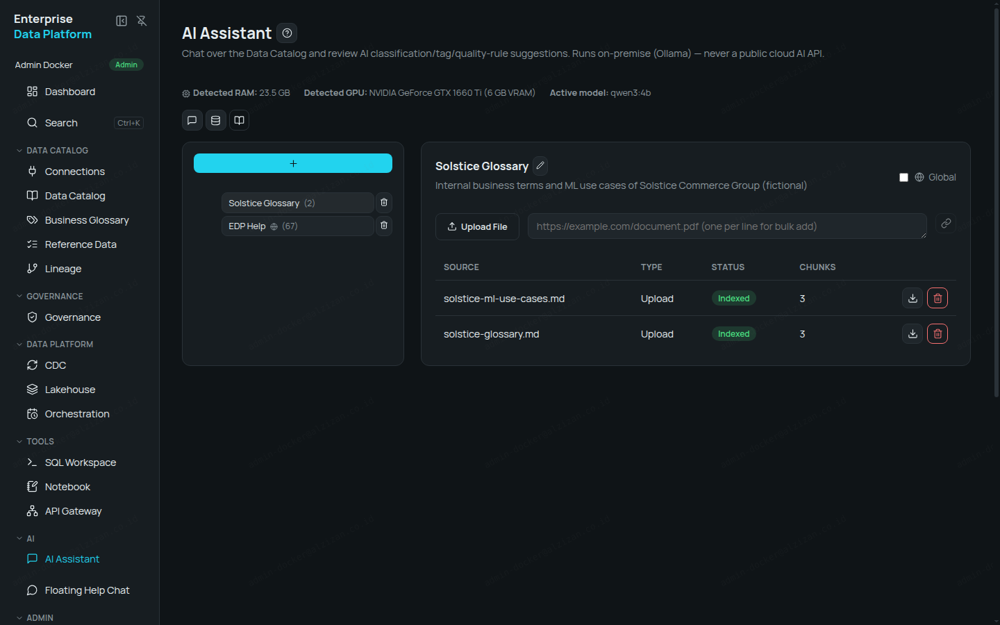
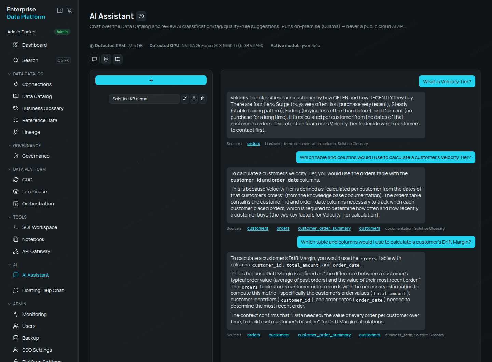
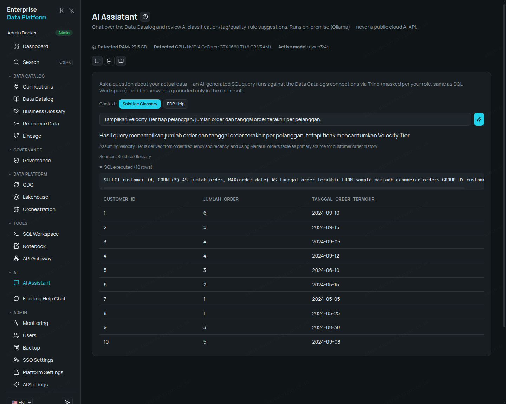

# Walkthrough — AI That Understands Made-Up Business Terms (Knowledge Base + Data Catalog + NL2SQL)

**Language:** [Bahasa Indonesia](README.md) · English

Enterprise Data Platform answers questions about **100% fictional** business terms — terms that don't
exist anywhere on the internet — by naming the right tables and columns in your database, and then
writes the SQL from a question asked in Indonesian. Every answer and screenshot below is real, run
**on-premise** (Ollama `qwen3:4b`, 6 GB consumer GPU) — no data is sent to a public AI service.

## Why This Test Is Convincing

- Two KB documents contain **100% made-up** business terms ("Velocity Tier", "Glimmer Score", "Drift
  Margin", etc.) belonging to the fictional company "Solstice Commerce Group" — an AI model cannot
  know these terms from general knowledge.
- The documents **never mention table or column names**. If the AI names the right tables and
  columns, it has connected the definitions in the Knowledge Base with the real schema in the Data
  Catalog.

## Setup (once, ±10 minutes)

1. **Sample data**: install the sample PostgreSQL (`ecommerce`) —
   `curl -fsSL https://get.alzizan.co.id/sample-data | bash -s -- --services postgres` —
   register it under **Connections**, then **Scan** (11 tables, including `customers`, `orders`,
   `products`).
2. **AI-Drafted Documentation** for `customers`, `orders`, `products` (Data Catalog → table detail →
   generate). Real result: 20 drafts, 46–145 seconds per table, all accurate — e.g.
   `orders.order_date` → "Date when the order was placed", `orders.total_amount` → "Total monetary
   value of the order". Review, then **Approve**.
3. **Knowledge Base**: create a KB "Solstice Glossary" (AI Assistant → Knowledge Base), upload
   `kb/solstice-glossary.md` and `kb/solstice-ml-use-cases.md` → each is indexed into 3 chunks.

   

4. (Recommended) **Admin → AI Settings** → row *AI Assistant chat* → Thinking **Off** (faster answers,
   still good quality for this case).

## Steps — Ask the AI Assistant (context: Data Catalog + Solstice Glossary)



**Q1 — "What is Velocity Tier?"** (19 seconds)
> Velocity Tier classifies each customer by how OFTEN and how RECENTLY they buy. There are four
> tiers: Surge, Steady, Fading, and Dormant. It is calculated per customer from the dates of that
> customer's orders. The retention team uses Velocity Tier to decide which customers to contact
> first.

**Q2 — "Which table and columns would I use to calculate a customer's Velocity Tier?"** (38 seconds)
> To calculate a customer's Velocity Tier, you would use the **orders** table with the
> **customer_id** and **order_date** columns. […] The orders table contains the customer_id and
> order_date columns necessary to track when each customer placed orders.

In another run the AI also explained why `customer_order_summary` is not enough (it doesn't store the
date of each order) — it rejected the summary table with a reason, rather than just guessing.

**Q3 — "Which table and columns would I use to calculate a product's Glimmer Score?"** (51 seconds)
> - **products table** (columns: `category`, `price`)
> - **orders table** (columns: `product_id`, `order_date`)

Matches the definition: price position within the category + how often products in that category are
ordered.

## Extra Step — A Steward Links the Term in the Business Glossary

For **Drift Margin**, retrieval at first leaned toward the `customers` table, and the AI answered
honestly that a table holding each order's value was not in its context — **it did not make things
up**.

A Data Steward then added the term **Drift Margin** to the **Business Glossary**, approved it, and
linked it to the `orders` table (±1 minute). The same question afterwards:

**Q4 — "Which table and columns would I use to calculate a customer's Drift Margin?"** (74 seconds)
> To calculate a customer's Drift Margin, you would use the `orders` table with columns
> `customer_id`, `total_amount`, and `order_date`. […] specifically the customer's order values
> (`total_amount`), customer identifiers (`customer_id`), and order dates (`order_date`) needed to
> determine the most recent order.

The message for customers: the quality of AI answers rises as metadata is curated (documentation +
glossary) — work done on the same platform.

## Bonus Step — Indonesian-Language NL2SQL with Fictional Terms (Ask Data)

**Ask Data** writes SQL from a question, runs it against real data, then explains the result — with
the "Solstice Glossary" Knowledge Base selected as context. The sample data contains 34 orders
(several orders per customer with different gaps and values) so that terms like Velocity Tier have
meaningful data. Recommended: AI Settings → *Auto SQL* & *Ask Data* → Thinking **Off**.

**Question (asked in Indonesian):** "Show each customer's Velocity Tier: number of orders and last
order date per customer." (19–38 seconds)

```sql
SELECT customer_id, COUNT(*) AS jumlah_order, MAX(order_date) AS tanggal_order_terakhir
FROM sample_mariadb.ecommerce.orders GROUP BY customer_id
```

> The query result shows the number of orders and the last order date per customer, but does not
> include the Velocity Tier.



The AI translated the made-up term "Velocity Tier" (defined only in the Knowledge Base) into the two
right signals — frequency (`COUNT(*)`) and recency (`MAX(order_date)`) — with no table or column name
in either the question or the KB documents. The result is immediately readable: customers 1, 2, and
10 buy often; 7 and 8 haven't ordered for a long time.

**Honest limitations (4B model, 6 GB GPU):**
- "Calculate Drift Margin…" needs "the most recent order value" (a window function per customer);
  `qwen3:4b` produced incomplete SQL (average + last date), and the AI answered honestly that the
  value couldn't be computed from that result.
- Asking the AI to also *group* customers into tiers from the query result sometimes produces an
  inaccurate numeric summary — treat the result table as the source of truth.
- For more complex analytical queries, use a larger model (e.g. `qwen3:8b` on a GPU ≥ 8 GB) via
  `curl -fsSL https://get.alzizan.co.id/pull-model | bash -s -- qwen3:8b` + AI Settings.

## Response Times (Honest)

- `qwen3:4b` on a 6 GB consumer GPU: 19–75 seconds per question with Thinking Off; can be 2–4 minutes
  with Thinking On and a large Catalog context.
- All inference is **on-premise** — no data or question leaves for a public AI service. On a bigger
  GPU these times are much shorter.

## Conclusion

End to end: **Knowledge Base → Data Catalog (scan + reviewed AI documentation) → AI Assistant →
answers that name real tables and columns, with clickable sources**. When the context isn't
sufficient, the AI admits it doesn't know; after the steward adds a glossary term, the answer is
right.

## Files

- [`kb/solstice-glossary.md`](kb/solstice-glossary.md), [`kb/solstice-ml-use-cases.md`](kb/solstice-ml-use-cases.md)
  — the two Knowledge Base documents that were uploaded (in English, with no table/column names). Use
  them to repeat this test on your own installation.

## Try It Yourself

- Free trial, no sales call: https://alzizan.co.id/register
- Want to see it with your team's use case? Request a demo, or a free in-house *Big Data & AI Tech Update* session at your office: sales@alzizan.co.id
- Demo videos: https://www.youtube.com/@AlzizanDigitalSolutions

---

The content of this repository is licensed under [CC BY 4.0](LICENSE). © PT Alzizan Digital Solutions.
